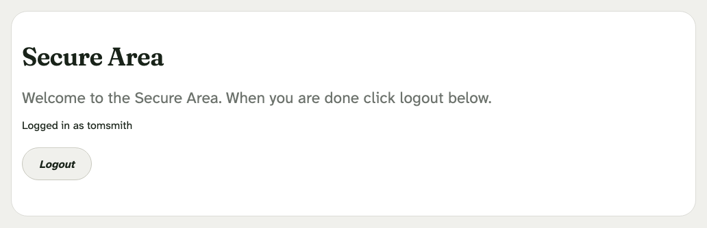
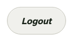

# The Secure Area

The Internet is a practice site with a page that only a logged-in user can open. Without a login, going to the secure area sends you back to the login page.

Once you are logged in, the secure area greets you:

When you are done, the page has a Logout button:

