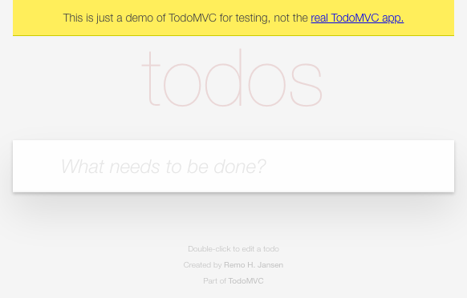
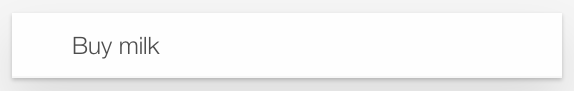
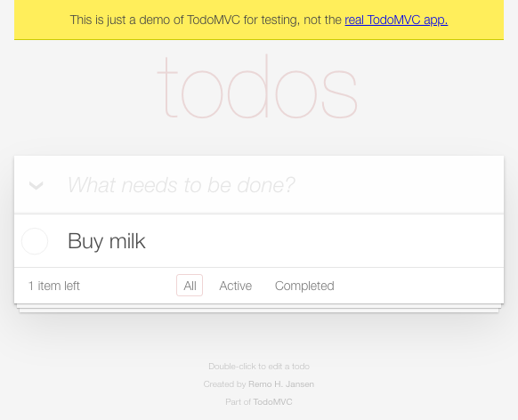
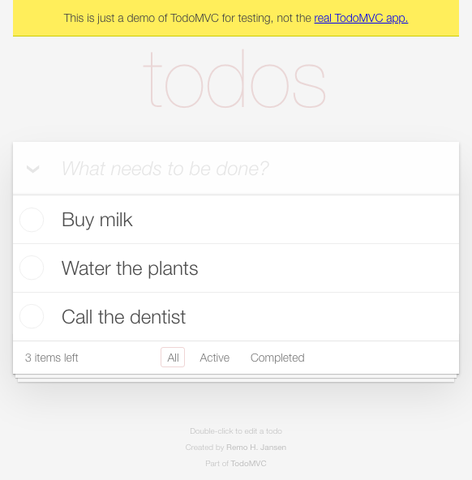
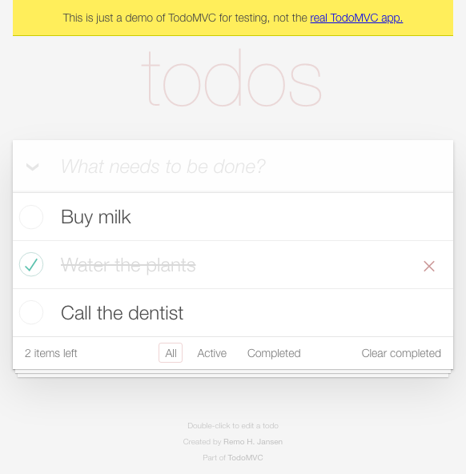
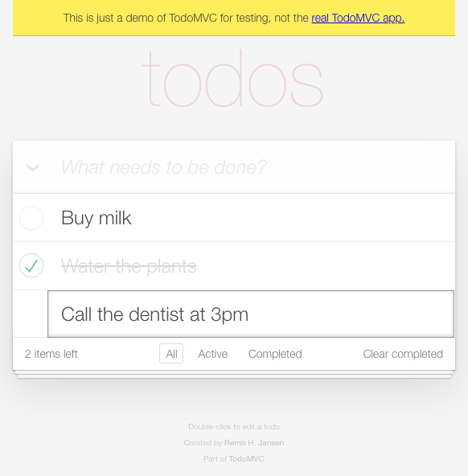
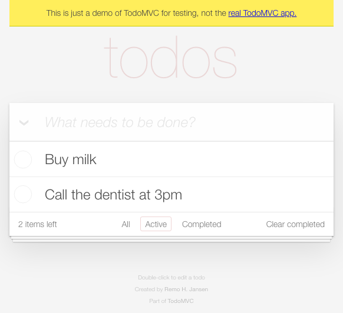
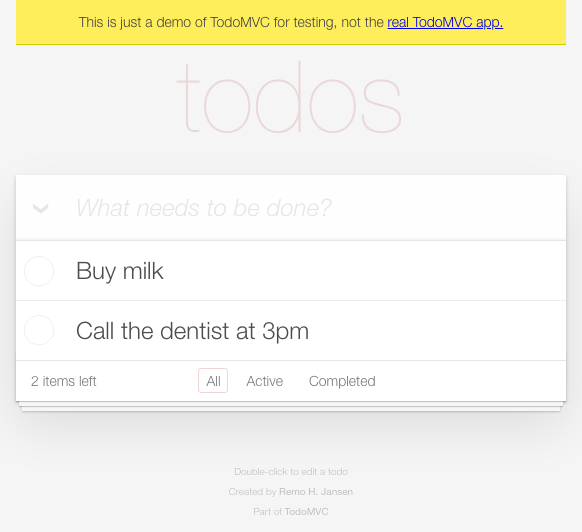

# TODO MVC

The playwright website has an example of a TODO MVC application that demonstrates how to use Playwright for end-to-end testing.

When you first arrive on the TODO MVC page, you will see an empty list and a textbox where you can enter new tasks:

You can type a task into that textbox:

After you finish typing in the task, press enter to add the task:

Add two more tasks the same way:

## Completing a task

Each task has a checkbox. You can mark it complete by clicking the checkbox:

## Deleting and editing

The delete button appears only while the pointer is over a task. You can *hover* over the task to reveal a red 'x' button:

Double-click a task to edit it. Then fill in the new text and press Enter to save:

## Filtering and clearing

The links at the bottom filter the list. You can click the *Active* link to show only the active tasks:

Or, you can clear the completed tasks with the link on the right, and then even when viewing *All* tasks, the completed tasks are gone:

